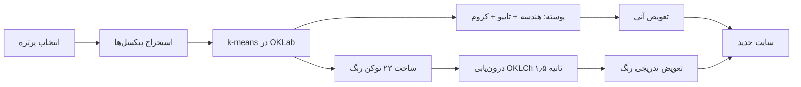

# وب‌سایت شخصی نمونه کارها


## معرفی

این پروژه یک وب‌سایت شخصی واکنش‌گرا و مدرن است که با استفاده از فناوری‌های React و Tailwind CSS ساخته شده است. این وب‌سایت نمونه کارهای حرفه‌ای، مهارت‌ها و اطلاعات تماس را به صورت زیبا و کاربرپسند نمایش می‌دهد.

## ویژگی‌ها

- طراحی واکنش‌گرا و سازگار با دستگاه‌های مختلف
- پشتیبانی از چند زبان (فارسی و انگلیسی) با i18next
- انیمیشن‌های جذاب با Framer Motion
- **گالری پرتره با تم پویا**: با تعویض عکس، کل طراحی و رنگ‌آمیزی سایت به‌طور خودکار با رنگ و نور همان عکس بازتنظیم می‌شود
- **دو پوسته‌ی طراحی مستقل**: با تعویض عکس، هندسه، تایپوگرافی، بافت و کروم صفحه هم عوض می‌شود — انگار دو سایت متفاوت در یک پروژه
- **استخراج پالت از تصویر**: رنگ‌ها با الگوریتم k-means در فضای رنگی OKLab/OKLCh از خود عکس استخراج می‌شوند
- نمایشگر پورتفولیو با قابلیت فیلتر کردن پروژه‌ها
- فرم تماس با EmailJS
- بهینه‌سازی SEO
- سازگار با قوانین PWA
- تم دارک مدرن و زیبا

## گالری و تم پویا

هر پرتره در گالری به یک **تم** و یک **پوسته‌ی طراحی** وصل است. با زدن دکمه بعدی/قبلی، دکمه‌های نقطه‌ای، کلیدهای جهت‌دار صفحه‌کلید یا چرخش خودکار:

1. تصویر با یک ترنزیشن سینمایی (لغزش + بلور) عوض می‌شود.
2. پالت رنگی از پیکسل‌های همان تصویر استخراج می‌شود.
3. ۲۳ توکن طراحی (accent، violet، magenta، gold، void، panel، text و…) در فضای OKLCh درون‌یابی می‌شوند.
4. **پوسته‌ی طراحی فوراً عوض می‌شود** — هندسه، تایپوگرافی، بافت و کروم — در حالی که رنگ طی ۱٫۵ ثانیه نرم می‌لغزد.

این تضاد عمدی است: **پوسته می‌پرد، رنگ می‌لغزد**. نتیجه‌اش این است که سایت مثل دو محصول متفاوت حس می‌شود، نه یک صفحه‌ی رنگ‌شده.

### دو پوسته

| پوسته | حس | ویژگی‌ها |
|---|---|---|
| **Studio Signal** | تمیز، محصولی، ادیتوریال | گوشه‌های گرد ۱۲px، Orbitron، شبکه‌ی ۵۲px کم‌رنگ، بدون کروم |
| **Cold Cyberpunk** | ترمینال نفوذی | گوشه‌های ۰، JetBrains Mono، باران کاراکتر، CRT، گلیچ RGB، نوار ترمینال DOS، HUD براکت، لاگ بوت |



### افزودن پرتره یا تم جدید

```js
// src/components/Hero.jsx → آرایه galleryItems
{ id: 'neon', themeId: 'neon', image: myImage, ... }

// src/theme/useThemeEngine.js → آرایه THEMES
{
  id: 'neon',
  image: myImage,
  design: 'neon',            // پوسته در src/theme/design.js
  direction: { hue: 320, accentChroma: 1.6, ... },
}
```


## نمونه کارها

این وب‌سایت شامل نمونه کارهای متنوعی است:

1. **Game Store**: فروشگاه بازی ساخته شده با React و TypeScript
2. **Crypto Way**: داشبورد ارزهای دیجیتال با React و Redux
3. **ChatBot AI**: چت‌بات هوشمند ساخته شده با Next.js
4. **Car 3D Web**: نمایش سه‌بعدی ماشین با Three.js و React

## فناوری‌های استفاده شده

- **React**: کتابخانه جاوا‌اسکریپت برای ساخت رابط کاربری
- **Tailwind CSS**: فریم‌ورک CSS برای طراحی رابط کاربری
- **Framer Motion**: کتابخانه انیمیشن برای React
- **i18next**: کتابخانه بین‌المللی‌سازی (i18n) برای چند زبانه کردن برنامه
- **EmailJS**: سرویس ارسال ایمیل بدون نیاز به سرور
- **React Icons**: مجموعه‌ای از آیکون‌های محبوب برای React
- **Vite**: ابزار توسعه مدرن و سریع برای React
- **OKLab / OKLCh**: فضای رنگی ادراکی برای درون‌یابی رنگ بدون تولید رنگ‌های کثیف در میانه مسیر

## نصب و راه‌اندازی

برای راه‌اندازی پروژه در محیط توسعه محلی خود، دستورات زیر را اجرا کنید:

```bash
# کلون کردن مخزن
git clone https://github.com/your-username/personalweb.git

# وارد شدن به پوشه پروژه
cd personalweb

# نصب وابستگی‌ها
npm install

# اجرای برنامه در محیط توسعه
npm run dev
```

سپس برنامه در آدرس `http://localhost:5173` قابل دسترس خواهد بود.

## دستورات مفید

- `npm run dev`: اجرای برنامه در محیط توسعه
- `npm run build`: ساخت نسخه نهایی برای انتشار
- `npm run preview`: پیش‌نمایش نسخه ساخته شده
- `npm run lint`: بررسی کد با ESLint

## بهینه‌سازی

این پروژه برای عملکرد و سرعت بهینه‌سازی شده است:

- استفاده از lazy loading برای تصاویر
- کد‌های تقسیم‌شده (code splitting) برای بارگذاری سریع‌تر
- استفاده از کش‌کردن و تکنیک‌های مدرن وب

## مجوز

این پروژه تحت مجوز MIT منتشر شده است. برای اطلاعات بیشتر به فایل LICENSE مراجعه کنید.

## تماس

برای سوالات یا همکاری، می‌توانید از طریق وب‌سایت یا ایمیل با من در ارتباط باشید.
